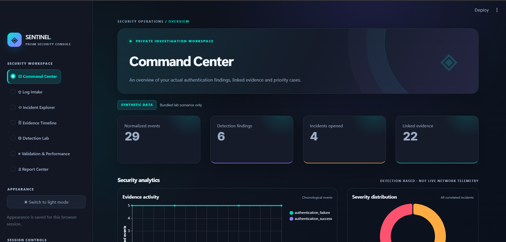
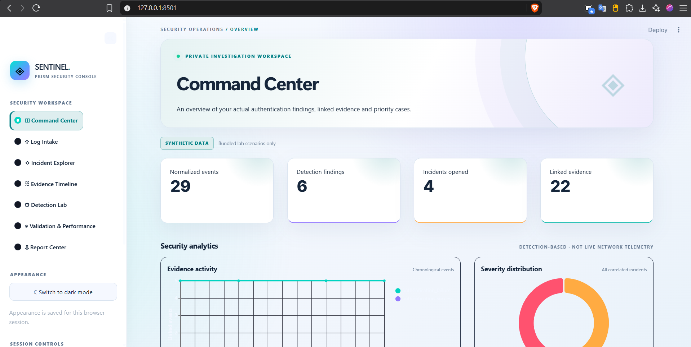
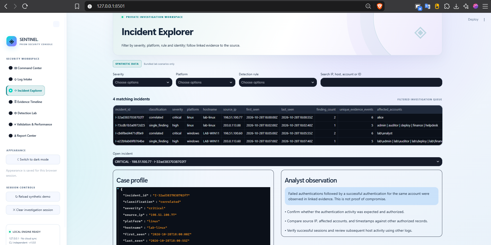
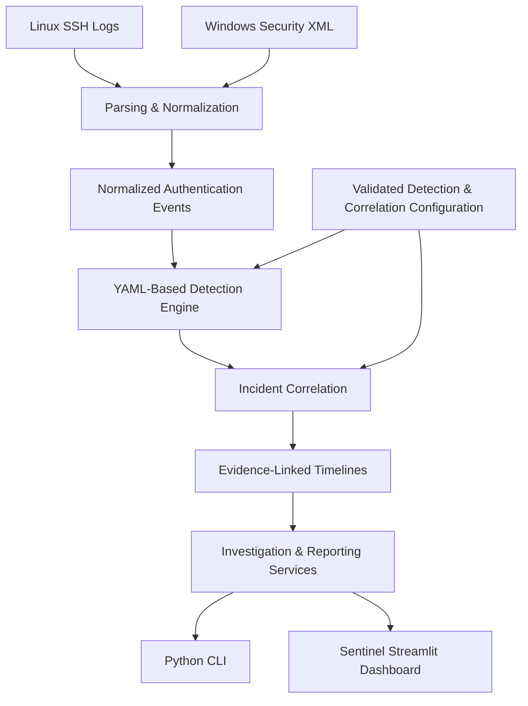

<div align="center">

# 🛡️ SENTINEL

### Security Automation & Log Correlation Toolkit

**A local-first cybersecurity investigation platform built with Python and Streamlit.**

Analyze authentication logs. Detect suspicious behavior. Correlate incidents. Investigate linked evidence.


[Explore Features](#-key-features) · [Quick Start](#-quick-start) · [Architecture](#-system-architecture) · [Project Documentation](#-documentation)

</div>

---

## 📸 Dashboard Preview

Sentinel features a seven-workspace investigation dashboard with dark and light appearance modes, configurable threat detection, interactive charts and evidence-linked investigations.

<div align="center">




**Command Center — Dark and Light Modes**



**Incident Explorer — Authentication Threat Investigation**

</div>

> Screenshots are captured from the actual locally running application using bundled synthetic demonstration data.

## 🎯 Project Overview

Sentinel is a Python-based security automation and investigation toolkit designed to demonstrate practical security operations center (SOC) workflows.

It processes Linux OpenSSH authentication logs and Windows Security XML event exports, normalizes events into a consistent format, and applies configurable detection rules to identify suspicious authentication patterns.

Related findings are grouped into incidents with traceable evidence and chronological timelines. Investigations can be explored through either the command-line interface or the local Streamlit dashboard.

### What problem does it solve?

Authentication evidence is often scattered across different operating systems, log formats and timestamps. Manual analysis makes it harder to connect repeated failures, suspicious account activity and subsequent successful logins.

Sentinel provides a repeatable workflow from raw authentication logs to evidence-linked investigation reports.

## ✨ Key Features

| Capability | Implementation |
|---|---|
| Cross-platform log analysis | Linux SSH/syslog and Windows Security XML |
| Event normalization | UTC timestamps, source IP, host, account and event references |
| Threat detection | Brute-force patterns, password spraying and success after failures |
| Incident correlation | Groups related findings using validated host, platform, IP and time boundaries |
| Evidence timelines | Chronological, traceable investigation evidence |
| Interactive SOC dashboard | Seven Streamlit workspaces with charts, filters and search |
| Appearance modes | Switch between Prism dark and light themes |
| Detection configuration | Session-based tuning of detection and correlation parameters |
| Investigation exports | Five CSV tables, complete JSON report and SHA-256 manifest |
| Defensive validation | Input limits, XML declaration safeguards and configuration checks |
| Testing | Pytest regression suite and synthetic security scenarios |

## 🖥️ Seven Dashboard Workspaces

| Workspace | Purpose |
|---|---|
| Command Center | Summarizes events, findings, incidents and evidence |
| Log Intake | Validates and analyzes supported authentication log uploads |
| Incident Explorer | Filters incidents and inspects evidence relationships |
| Evidence Timeline | Presents linked authentication events chronologically |
| Detection Lab | Adjusts detection thresholds for the current browser session |
| Validation & Performance | Runs synthetic detection validation and bounded benchmarks |
| Report Center | Exports structured investigation data and integrity manifests |

All seven workspaces use the same underlying Python analysis services as the CLI.

## 🏗️ System Architecture



**Architecture principle:** The command-line interface and Streamlit dashboard share the same analysis, validation and reporting backend. Security logic is not duplicated in the interface.

See [Architecture Documentation](docs/ARCHITECTURE.md) for additional diagrams and design decisions.

## 🛠️ Technology Stack

| Category | Technologies |
|---|---|
| Core language | Python 3.13 |
| Dashboard | Streamlit, Pandas, Altair |
| Detection configuration | YAML, PyYAML |
| Testing | Pytest |
| Source control | Git, GitHub |
| Data formats | Syslog, Windows Security XML, JSON, CSV |
| Development environment | VS Code, Windows 11 |
| Deployment | Local Python application |

## 🚀 Quick Start

### Requirements

- Python 3.13 or newer
- Git
- A supported web browser
- Internet connection for installing Python dependencies

### 1. Clone the repository

```powershell
git clone https://github.com/Abdullah-Al-Mahi/python-security-log-toolkit.git

cd python-security-log-toolkit
```

### 2. Create a virtual environment

```powershell
py -3.13 -m venv .venv
```

### 3. Install dependencies

```powershell
.\.venv\Scripts\python.exe -m pip install -e ".[dev,web]"
```

### 4. Start the Sentinel dashboard

```powershell
.\.venv\Scripts\python.exe -m streamlit run dashboard\app.py --server.address 127.0.0.1 --server.port 8501
```

Open:

**http://127.0.0.1:8501**

The application loads bundled synthetic authentication data so the dashboard can be explored without supplying real security logs.

Press **Ctrl+C** in the terminal to stop the local server.

> The dashboard is designed for a single local user. It does not include authentication and must not be exposed directly to the public internet.

## 🔎 Command-Line Investigation

The toolkit can also operate independently of Streamlit.

Example: analyze the bundled Linux and Windows authentication samples.

```powershell
.\.venv\Scripts\python.exe -m security_log_toolkit analyze --linux samples/linux/attack_auth.log --windows samples/windows/attack_security.xml --year 2026 --utc-offset +08:00 --output reports/investigation.json
```

Display the investigation summary:

```powershell
.\.venv\Scripts\python.exe -m security_log_toolkit report --input reports/investigation.json
```

The `reports/` directory is intended for local generated artifacts and is excluded from publication, except for its empty Git placeholder.

## 📊 Reproducible Demonstration Results

The bundled synthetic investigation generates the following results:

| Measurement | Result |
|---|---:|
| Authentication events | 29 |
| Detection findings | 6 |
| Incidents | 4 |
| Linked evidence events | 22 |
| Synthetic validation scenarios | 4 |
| Scenario-level true positives | 6 |
| Scenario-level false positives | 0 |
| Scenario-level false negatives | 0 |

The labeled synthetic scenarios produce precision, recall and F1 scores of 1.0 for the evaluated rule/source-IP combinations.

**These results do not establish real-world detection accuracy, production throughput or confirmed system compromise.**

### Automated testing

At the Phase 10 Windows acceptance milestone, the project passed **460 automated tests**, including a Streamlit smoke test.

Subsequent UI revisions should be retested before a newer passing test count is claimed.

Run the regression suite:

```powershell
.\.venv\Scripts\python.exe -m pytest -q
```

Check the development environment:

```powershell
.\.venv\Scripts\python.exe -m security_log_toolkit doctor
```

## 🔐 Security & Privacy Considerations

Sentinel was developed with defensive input validation and local execution in mind.

- Uploaded raw files are size-limited and processed using temporary storage.
- Windows XML document type and entity declarations are rejected.
- Configuration files are validated before use.
- Report outputs include safeguards against CSV formula injection.
- SHA-256 manifests support export integrity verification.
- The dashboard does not automatically publish investigation data.
- Browser session memory may retain uploaded content until cleared or the application exits.

**Supported input scope:** Linux OpenSSH authentication logs and Windows Security XML Event IDs 4624/4625. Binary `.evtx` files require conversion to supported XML before analysis.

This project is an educational and portfolio-oriented security investigation prototype, not a production SIEM, forensic chain-of-custody solution or automated incident-response system.

Only analyze data that you are authorized to access.

## 📁 Project Structure

```text
python-security-log-toolkit/
├── .github/
├── .streamlit/
├── config/
├── dashboard/
│   ├── app.py
│   └── sentinel.css
├── docs/
│   ├── screenshots/
│   ├── ARCHITECTURE.md
│   ├── PORTFOLIO_CASE_STUDY.md
│   └── DEMO_WALKTHROUGH.md
├── samples/
├── scripts/
├── src/
│   └── security_log_toolkit/
├── tests/
├── README.md
├── LICENSE
└── pyproject.toml
```

## 📚 Documentation

| Document | Description |
|---|---|
| [Architecture](docs/ARCHITECTURE.md) | System components, investigation pipeline and design diagrams |
| [Portfolio Case Study](docs/PORTFOLIO_CASE_STUDY.md) | Engineering approach, results, tradeoffs and project scope |
| [Demo Walkthrough](docs/DEMO_WALKTHROUGH.md) | Reproducible interview demonstration |
| [CLI Guide](docs/CLI_GUIDE.md) | Command-line operations |
| [Reporting Guide](docs/REPORTING_GUIDE.md) | Export structure and evidence relationships |
| [Security Validation](docs/SECURITY_VALIDATION_GUIDE.md) | Synthetic testing methodology and limitations |

## 📜 License

Distributed under the [MIT License](LICENSE), subject to the copyright and attribution stated in the repository.

---

<div align="center">

**Sentinel Prism — Security investigation, backed by traceable evidence.**

Built as a cybersecurity and Python engineering portfolio project.

[Back to Top](#️-sentinel)

</div>
