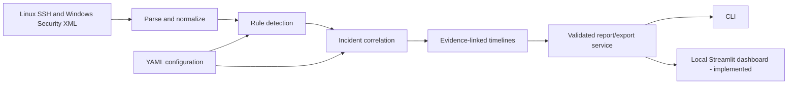

# Python Security Automation & Log Correlation Toolkit

**Offline-first security log analysis and incident investigation, built with Python.**

A cybersecurity portfolio project that turns Linux OpenSSH and Windows Security
XML authentication events into reproducible **detections, correlated incidents,
evidence-linked timelines and analyst-ready CSV/JSON reports**. Developed using
free tools with no API key, cloud service, database server or subscription.

**Current milestone: Phase 10 — Local Web Dashboard** · **Version: 1.0.0** ·
**Dashboard code implemented; Windows browser acceptance still pending.**

> **Reproducible demo data is synthetic.** A login-success alert does not prove
> compromise. The synthetic detection labels and benchmarks are not production
> detection-accuracy or SIEM-scale performance claims.

## Why build this?

SOC investigations often combine evidence from different host log formats.
Instead of simply counting failed logins, this toolkit normalizes the evidence,
detects authentication patterns with configurable rules, links findings to
incidents, reconstructs linked-evidence timelines, and exports traceable results.

## Features at a glance

| Area | Implemented capability |
|---|---|
| Parsing | Linux `sshd` syslog; Windows Security XML Event IDs 4624/4625 |
| Normalization | UTC timestamps, host/account/IP attributes and source references |
| Detections | Brute force, password spray, and success after failures (YAML rules) |
| Correlation | Stable IDs, host/IP/platform separation, bounded time windows |
| Investigation | Chronological linked evidence with conservative analyst summaries |
| Reporting | Five linked CSV tables, JSON investigation report, SHA-256 manifest |
| CLI | `parse`, `detect`, `correlate`, `timeline`, `analyze`, `report`, `export`, `config`, `doctor` |
| Security | Input size limits, XML entity/DTD rejection, configuration validation, output safeguards |
| Quality | Adversarial tests, labeled synthetic detection scenarios, bounded benchmarks |
| Portfolio | Repeatable offline demo, publication preflight and editable Mermaid architecture diagrams |
| Local dashboard | **Sentinel** Streamlit command center, uploads, charts, incidents, timelines, rule controls, validation, downloads |

## Architecture



See [architecture, sequence and evidence relationship diagrams](docs/ARCHITECTURE.md)
for complete, editable diagram source.

## Run it locally (Windows 11 + VS Code)

Requirements: **Python 3.13+**, VS Code terminal and Git. The project uses
PyYAML at runtime and pytest for tests. These are freely available libraries.

If you already have the project's `.venv`, **keep it**. In PowerShell at the
repository root:

```powershell
.\.venv\Scripts\python.exe -m pip install -e ".[dev]"
.\.venv\Scripts\python.exe -m security_log_toolkit --version
.\.venv\Scripts\python.exe -m security_log_toolkit doctor
.\.venv\Scripts\python.exe -m pytest -q
```

A new checkout can create a virtual environment using:

```powershell
py -3.13 -m venv .venv
.\.venv\Scripts\python.exe -m pip install -e ".[dev]"
```

On Linux/macOS use `python3.13 -m venv .venv` and `.venv/bin/python` instead.
No Windows activation policy change is needed when calling the Python
interpreter in the virtual environment directly.

## Phase 10 — Launch the private local SOC dashboard

The modern **Sentinel** dashboard is implemented using the *same* Python
analysis and reporting services as the CLI. Streamlit is an optional free
dependency and is **not needed to run any existing CLI command**.

```powershell
.\.venv\Scripts\python.exe -m pip install -e ".[dev,web]"
.\.venv\Scripts\python.exe -m streamlit run dashboard\app.py --server.address 127.0.0.1 --server.port 8501
```

Open **http://127.0.0.1:8501** on your own laptop. Keep the terminal open;
press **Ctrl+C** to stop. The dashboard initially displays the bundled
synthetic sample. It also accepts bounded raw Linux/Windows XML uploads,
loads earlier investigation JSON, filters incidents and evidence timelines,
lets you adjust detection thresholds for the current session, runs synthetic
validation/benchmarking, and downloads the same seven CSV/JSON/manifest files.

The app binds only to loopback by default, **has no login system**, and must
**not** be exposed to a network or used as a hosted multi-user SIEM. Uploaded
raw files are processed in temporary files, but Streamlit's browser session
may retain raw upload data in server memory until cleared. No reports are
automatically uploaded or published. Never upload private data without
permission. See [full local dashboard guide](docs/WEB_DASHBOARD_GUIDE.md).

**Acceptance:** The web implementation has been integrated and backend tests
are passing locally, but it must be tested in the user's Windows 11 browser
before the project is declared finished.

## One-command, reproducible portfolio demonstration

This command calls the **same backend used by the CLI** and writes demonstration
artifacts derived only from the checked-in synthetic fixtures:

```powershell
.\.venv\Scripts\python.exe scripts/demo_portfolio.py --output-dir reports/phase9_demo
```

The output is intentionally created **once**. Repeated runs must specify a new
directory, for example `reports/phase9_demo_2`; the script never overwrites an
existing report directory.

The demo writes an analyst summary, investigation JSON, five linked CSV tables,
a complete export manifest, a synthetic validation summary, and a portfolio
SHA-256 manifest. All files remain local and should stay outside Git.

| Synthetic demo metric | Expected |
|---|---:|
| Authentication events | 29 |
| Detection findings | 6 |
| Correlated + individual incidents | 4 |
| Linked evidence records | 22 |
| Manually labeled scenarios / events | 4 / 41 |
| Scenario rule/IP TP / FP / FN | 6 / 0 / 0 |

**Precision, recall and F1 = 1.0 on the fixed synthetic scenario labels only.**
This does not describe real-world detector accuracy, account compromise, or
statistical confidence. The benchmark reports in-memory service timing and is
not an end-to-end ingest or UI performance test.

## Everyday commands

```powershell
# Analyze raw Linux and Windows data and write a JSON investigation report
.\.venv\Scripts\python.exe -m security_log_toolkit analyze --linux samples/linux/attack_auth.log --windows samples/windows/attack_security.xml --year 2026 --utc-offset +08:00 --output reports/investigation.json

# Read the analyst summary
.\.venv\Scripts\python.exe -m security_log_toolkit report --input reports/investigation.json

# Create five CSV tables, JSON and integrity manifest
.\.venv\Scripts\python.exe -m security_log_toolkit export --input reports/investigation.json --format both --output-dir reports/investigation_exports

# Verify labeled synthetic detections; independently check local throughput
.\.venv\Scripts\python.exe -m security_log_toolkit validate --output reports/validation.json
.\.venv\Scripts\python.exe -m security_log_toolkit benchmark --events 1000 --runs 3 --output reports/benchmark.json
```

An existing output path is normally rejected. The CLI supports explicitly
controlled `--force` on selected commands; it protects input files and
configuration paths. Native Windows binary `.evtx` is **not** supported: first
export the relevant Security events to XML through authorized tooling.

See [CLI guide](docs/CLI_GUIDE.md),
[reporting guide](docs/REPORTING_GUIDE.md), and
[validation limits](docs/SECURITY_VALIDATION_GUIDE.md).

## Security and privacy / before GitHub publication

Real authentication logs may contain personal identifiers, network details and
security-relevant information. **Do not commit real log files, incident exports,
credentials, private key material or `.venv/`.** Before any approved remote
publication run:

```powershell
.\.venv\Scripts\python.exe scripts/audit_portfolio.py
git status --short
git ls-files
```

The audit checks tracked paths and a limited set of token patterns **offline**;
it cannot prove that a repository, its full Git history or its screenshots are
free of secrets. Manually review your existing `.gitignore`, license, samples,
and Git history using the [release checklist](docs/RELEASE_CHECKLIST.md).

**Nothing in Phase 9 or Phase 10 uploads or publishes this project automatically.**
A manual-only GitHub Actions test workflow is included for later optional use;
its remote execution is not required and availability/usage allowances can vary.

## Interview-ready documentation

- [Five-minute demonstration script](docs/DEMO_WALKTHROUGH.md)
- [Architecture and editable Mermaid diagrams](docs/ARCHITECTURE.md)
- [Portfolio case study and CV bullets](docs/PORTFOLIO_CASE_STUDY.md)
- [Screenshot capture guide](docs/SCREENSHOT_GUIDE.md) (no fabricated screenshots)
- [Publication/privacy review](docs/RELEASE_CHECKLIST.md)
- [Official Phase 0–10 roadmap](docs/ROADMAP.md)
- [Phase 10 dashboard handoff](docs/PHASE10_HANDOFF.md)

## Limitations and roadmap

The tool is an **offline authentication-log prototype**, not a real-time SIEM or
forensic chain-of-custody platform. Linked timelines are not complete system
activity. It does not collect logs from remote hosts or establish attribution.

**Phase 9** delivered documentation and reproducible portfolio evidence.
**Phase 10** implements the required Streamlit dashboard with upload/analyze,
incident exploration, charts, timelines, session-only configuration,
validation and CSV/JSON downloads, all backed by the existing Python services.
The CLI is still fully functional. **Final project acceptance is pending
Windows 11 browser and CLI verification.**

## License

See the repository's existing [`LICENSE`](LICENSE) file; do not replace its
original author or license terms without authorization.
