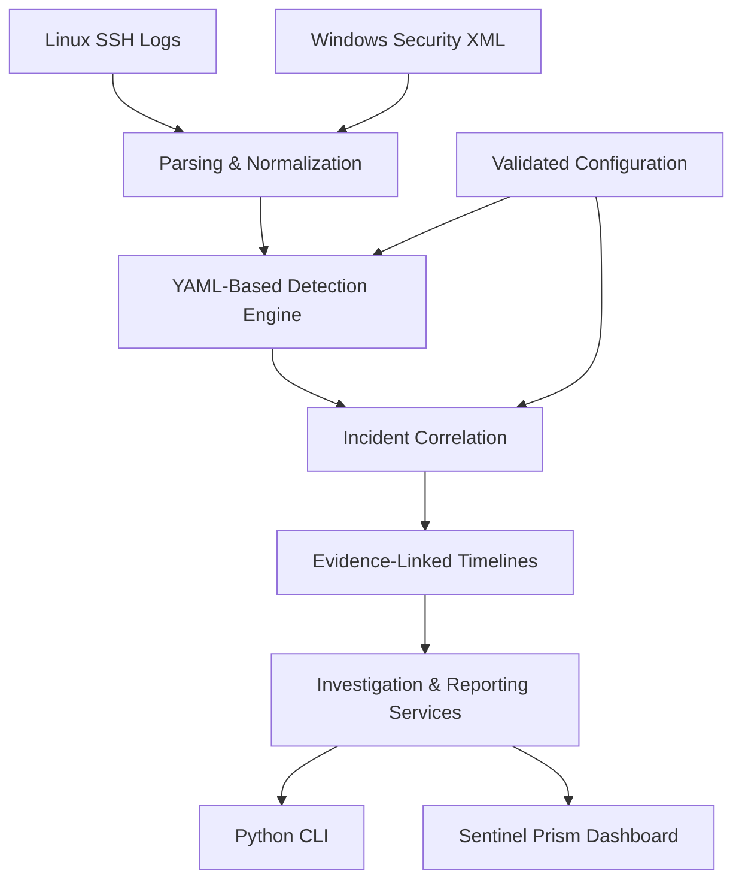

<div align="center">

# 🛡️ SENTINEL
### Security Automation & Log Correlation Toolkit

**A Python-based SOC investigation platform featuring the Sentinel Prism dashboard.**

Linux & Windows Authentication Analysis · Threat Detection · Incident Correlation · Evidence Investigation


[Dashboard Preview](#-dashboard-preview) · [Features](#-key-features) · [Quick Start](#-quick-start) · [Documentation](#-documentation)

</div>

---

## 📸 Dashboard Preview

I developed Sentinel Prism as a local security investigation interface with interactive charts, incident exploration, evidence timelines, and light/dark appearance modes.

<div align="center">


**Command Center — Dark and Light Modes**


**Incident Explorer — Authentication Security Investigation**

</div>

*These screenshots are from my locally running application using synthetic demonstration data.*

## 🎯 About the Project

I built Sentinel to explore how security automation can make authentication log analysis and incident investigation more structured, consistent, and traceable.

Linux and Windows represent authentication activity differently. Manually reviewing these logs can make it difficult to recognize repeated failed logins, password spraying, and suspicious sequences involving successful authentication.

My solution uses Python to normalize supported authentication events, apply configurable detection rules, correlate related findings, and generate evidence-linked investigation timelines.

I also developed an interactive Streamlit dashboard so the same analysis can be explored visually, without depending entirely on command-line output.

**The project is an independent cybersecurity portfolio implementation designed for local, reproducible demonstrations.**

## ✨ Key Features

| Capability | Implementation |
|---|---|
| Authentication log parsing | Linux OpenSSH logs and Windows Security XML |
| Event normalization | Consistent UTC timestamps, hostnames, accounts, IP addresses, and evidence references |
| Threat detection | Brute-force patterns, password spraying, success after failures |
| Incident correlation | Groups related findings within defined platform, host, IP, and time boundaries |
| Investigation timelines | Chronological views of linked detection evidence |
| Interactive dashboard | Seven Streamlit workspaces |
| Appearance modes | Sentinel Prism light and dark themes |
| Detection configuration | Validated, session-based threshold adjustments |
| Reporting | Five CSV tables, JSON investigation data, SHA-256 manifest |
| Security controls | Input-size limits, XML declaration rejection, YAML validation, CSV safeguards |
| Automated tests | Pytest regression and security validation tests |

## 🖥️ Sentinel Prism Dashboard

The dashboard contains seven connected workspaces.

| Workspace | What I Implemented |
|---|---|
| Command Center | Summary metrics, charts, severity breakdowns, and priority investigations |
| Log Intake | Controlled upload and analysis of supported authentication logs |
| Incident Explorer | Searchable and filterable incident details |
| Evidence Timeline | Chronological events and source references |
| Detection Lab | Configuration controls for the current browser session |
| Validation & Performance | Synthetic detection evaluation and bounded benchmarks |
| Report Center | CSV, JSON, and ZIP downloads with integrity metadata |

The dashboard and CLI reuse the same Python backend. I intentionally kept the detection and correlation logic outside Streamlit to avoid maintaining two separate implementations.

## 🏗️ System Architecture



I designed the processing pipeline around reusable Python modules. The CLI and dashboard consume the same investigation and reporting services.

[Read the detailed architecture documentation](docs/ARCHITECTURE.md).

## 🛠️ Technology Stack

| Area | Technologies |
|---|---|
| Programming | Python 3.13 |
| Dashboard | Streamlit, Pandas, Altair |
| Detection rules | YAML, PyYAML |
| Testing | Pytest |
| Source control | Git, GitHub |
| Supported inputs | Linux SSH/syslog, Windows Security XML |
| Report formats | CSV, JSON |
| Development environment | Windows 11, VS Code |
| Deployment | Local-only application |

## 🚀 Quick Start

### Requirements

- Python 3.13 or newer
- Git
- A supported browser
- Internet access for the initial dependency installation

### 1. Clone the repository

```powershell
git clone https://github.com/Abdullah-Al-Mahi/python-security-log-toolkit.git
cd python-security-log-toolkit
```

### 2. Create a virtual environment

```powershell
py -3.13 -m venv .venv
```

### 3. Install the application

```powershell
.\.venv\Scripts\python.exe -m pip install -e ".[dev,web]"
```

### 4. Launch Sentinel Prism

```powershell
.\.venv\Scripts\python.exe -m streamlit run dashboard\app.py --server.address 127.0.0.1 --server.port 8501
```

Open **http://127.0.0.1:8501**.

The dashboard initially loads the bundled synthetic authentication dataset, allowing its features to be explored without providing private log files.

Press **Ctrl+C** in the terminal to stop the server.

> Sentinel is a local single-user prototype. It does not provide application-level authentication and should not be exposed directly to the public internet.

## 💻 Command-Line Analysis

I also maintained a standalone CLI for automated analysis and report generation.

Analyze the synthetic Linux and Windows samples:

```powershell
.\.venv\Scripts\python.exe -m security_log_toolkit analyze --linux samples/linux/attack_auth.log --windows samples/windows/attack_security.xml --year 2026 --utc-offset +08:00 --output reports/investigation.json
```

Display the investigation summary:

```powershell
.\.venv\Scripts\python.exe -m security_log_toolkit report --input reports/investigation.json
```

Export the investigation:

```powershell
.\.venv\Scripts\python.exe -m security_log_toolkit export --input reports/investigation.json --format both --output-dir reports/investigation_exports
```

Generated investigation files are intended to remain local and are excluded from Git tracking by default.

## 📊 Testing & Reproducible Results

### Synthetic Investigation

| Measurement | Result |
|---|---:|
| Authentication events | 29 |
| Detection findings | 6 |
| Incidents | 4 |
| Linked evidence events | 22 |
| Labeled validation scenarios | 4 |
| True positives | 6 |
| False positives | 0 |
| False negatives | 0 |

The validation uses four manually labeled synthetic scenarios. Precision, recall, and F1 were 1.0 for the evaluated scenario-level rule/IP labels.

**These metrics do not establish real-world detection accuracy or confirmed compromise.**

### Automated Testing

At my completed Phase 10 acceptance milestone, the project passed **460 automated tests** on Windows 11, including a Streamlit smoke test.

I subsequently refined the dashboard interface, so the latest code should be revalidated before citing a newer test count.

Run all tests:

```powershell
.\.venv\Scripts\python.exe -m pytest -q
```

Check the local environment:

```powershell
.\.venv\Scripts\python.exe -m security_log_toolkit doctor
```

For the full testing methodology, see [Security Validation](docs/SECURITY_VALIDATION_GUIDE.md).

## 🔐 Security & Privacy

I incorporated defensive checks throughout the toolkit, including:

- Raw log upload limits and temporary file processing.
- XML document type and entity declaration rejection.
- Validated YAML configuration schemas.
- Explicit year and timezone information for Linux syslog.
- Evidence and incident relationship validation.
- CSV spreadsheet-formula safeguards.
- SHA-256 file integrity manifests.
- Controlled output replacement behavior.

Raw uploads are not automatically committed or published. However, Streamlit may retain uploaded content in server memory during an active session.

**Limitations:** This is not a production SIEM, live monitoring platform, authenticated multi-user application, or forensic chain-of-custody system. Native binary `.evtx` files are not supported. Windows Security XML authentication events 4624/4625 and supported Linux OpenSSH logs form the input scope.

Only logs obtained with appropriate authorization should be analyzed.

## 📂 Repository Structure

```text
python-security-log-toolkit/
├── .github/
├── .streamlit/
├── config/
├── dashboard/
│   ├── app.py
│   └── sentinel.css
├── docs/
│   ├── screenshots/
│   ├── ARCHITECTURE.md
│   ├── PORTFOLIO_CASE_STUDY.md
│   └── WEB_DASHBOARD_GUIDE.md
├── samples/
├── scripts/
├── src/
│   └── security_log_toolkit/
├── tests/
├── README.md
├── LICENSE
└── pyproject.toml
```

## 📚 Documentation

| Document | Description |
|---|---|
| [Architecture](docs/ARCHITECTURE.md) | Components, processing pipeline, and trust boundaries |
| [Portfolio Case Study](docs/PORTFOLIO_CASE_STUDY.md) | My design approach, engineering challenges, and results |
| [Demo Walkthrough](docs/DEMO_WALKTHROUGH.md) | Five-minute project demonstration |
| [Dashboard Guide](docs/WEB_DASHBOARD_GUIDE.md) | Installation, operation, and privacy limitations |
| [CLI Guide](docs/CLI_GUIDE.md) | Command-line analysis and configuration |
| [Reporting Guide](docs/REPORTING_GUIDE.md) | CSV/JSON formats and integrity metadata |
| [Security Validation](docs/SECURITY_VALIDATION_GUIDE.md) | Test methodology and limitations |
| [Development Roadmap](docs/ROADMAP.md) | Completed development phases |
| [Screenshot Guide](docs/SCREENSHOT_GUIDE.md) | Documentation and presentation images |

## 📜 License

This project is distributed under the [MIT License](LICENSE), subject to the copyright and attribution stated there.

---

<div align="center">

**SENTINEL PRISM**

*Security investigation backed by traceable evidence.*

Developed as my Python and cybersecurity engineering portfolio project.

</div>
