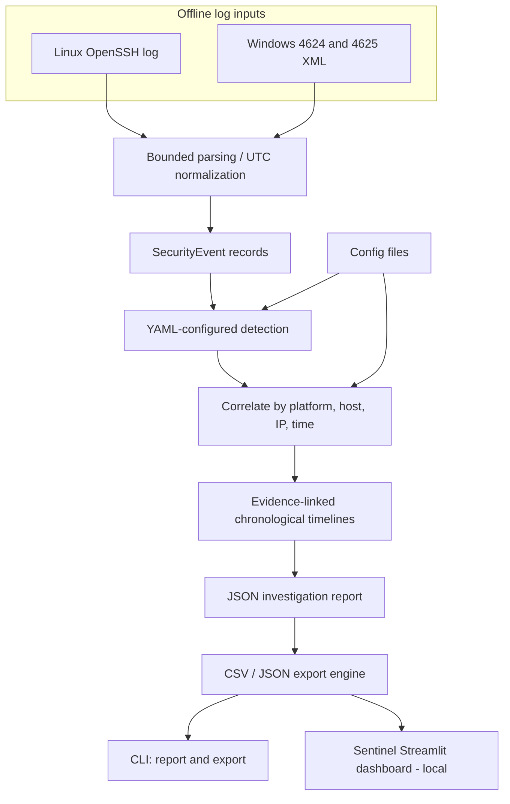
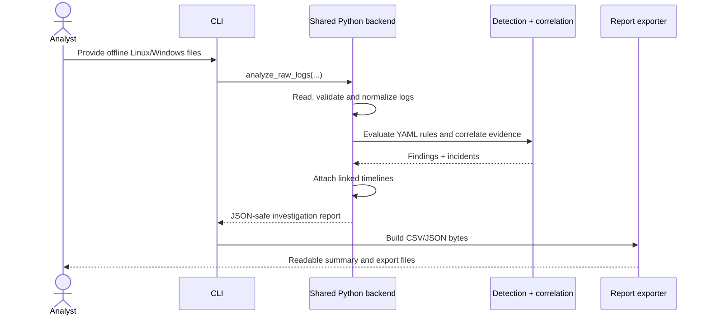
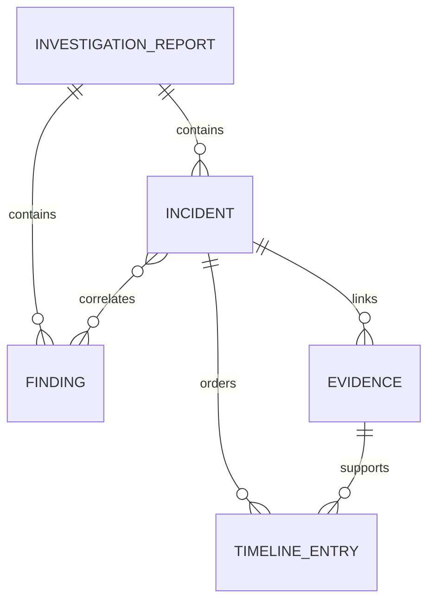

# Architecture and trust boundaries

**Phase 10 | Python Security Automation & Log Correlation Toolkit | v1.0.0 (verification pending)**

The project is deliberately **offline-first** and framework-neutral. Its Python
services do not need Streamlit, web hosting, paid APIs, or an external database.
The CLI remains operational. The **Phase 10 local dashboard is implemented**
using shared services. All processing uses local files and YAML configurations.

## Processing pipeline

Editable diagram source: [`diagrams/architecture.mmd`](diagrams/architecture.mmd).

## Module contracts

| Package/module | Responsibility | Reusable API |
|---|---|---|
| `parsers/linux.py`, `parsers/windows.py`, `ingest.py` | Parse accepted offline formats and normalize to UTC | `ingest_file()` |
| `events.py` | Normalized event representation and serialization | `SecurityEvent` |
| `detection/config.py`, `detection/engine.py` | Safe YAML configuration and brute force/spray/failure-to-success detection | `load_detection_config()`, `detect_events()` |
| `correlation/engine.py`, `correlation/service.py` | Deterministic grouping of findings and evidence | `investigate_events()` |
| `investigation/timeline.py`, `investigation/service.py` | Chronological linked-evidence timelines and conservative narratives | `attach_timelines()` |
| `workflow.py` | One-step raw-log analysis, without intermediate JSON files | `analyze_raw_logs()` |
| `reporting/export.py` | Validated summary, CSV/JSON bytes, integrity manifest | `build_report_tables()`, `build_export_artifacts()` |
| `quality/accuracy.py`, `quality/benchmark.py` | Scenario-label checks and bounded in-memory throughput | `evaluate_scenarios()`, `run_benchmark()` |
| `portfolio.py` | Reproducible demo artifacts from *synthetic* logs | `build_portfolio_artifacts()` |
| `dashboard/service.py` | Safe temporary uploads, session-only rule YAML, filtering, ZIP export | `analyze_uploaded_sources()`, `build_dashboard_zip()` |
| `dashboard/app.py` | Streamlit presentation; loopback-only server settings | Local browser app |
| `cli.py` | Terminal flags and file I/O; no duplicated detector implementation | `main()` |

## Investigation sequence

Editable source: [`diagrams/investigation.mmd`](diagrams/investigation.mmd).

## Evidence relationships

Editable source: [`diagrams/evidence_relationships.mmd`](diagrams/evidence_relationships.mmd).

## Trust boundaries, known limits and measured scope

1. **Input boundaries:** bounded local files (16 MiB raw files, 32 MiB normalized
   JSON, 50 MiB timeline incident JSON). Linux lines capped at 65,536 characters.
   Explicit Linux year and UTC offset are required to resolve ambiguous syslog times.
2. **XML boundaries:** rejects DTD/entity declarations and malformed XML. Accepts
   exported Windows Security XML for 4624/4625 only, not native `.evtx` binaries.
3. **Configuration:** uses safe, schema-checked YAML settings; rule IDs, thresholds
   and severity must validate before processing.
4. **Identity and correlation:** distinct hosts, platforms and source IPs are not
   merged; evidence identifiers remain stable for a given input and rule config.
5. **Output:** JSON/CSV exports validate relationships, guard against spreadsheet
   formulas, and include SHA-256 content hashes. Hashes are not digital signatures.
6. **Detection claims:** a failure followed by success is an investigative signal,
   not proof of credential compromise. Timelines include **linked detection
   evidence**, not full source history.
7. **Privacy:** this is an offline analyst prototype, not a production SIEM. A
   machine-local Streamlit app in Phase 10 must use localhost binding and must
   never upload real logs to a public service by default.

See [`SECURITY_VALIDATION_GUIDE.md`](SECURITY_VALIDATION_GUIDE.md) and
[`PHASE10_HANDOFF.md`](PHASE10_HANDOFF.md) for detailed limits and UI boundaries.
