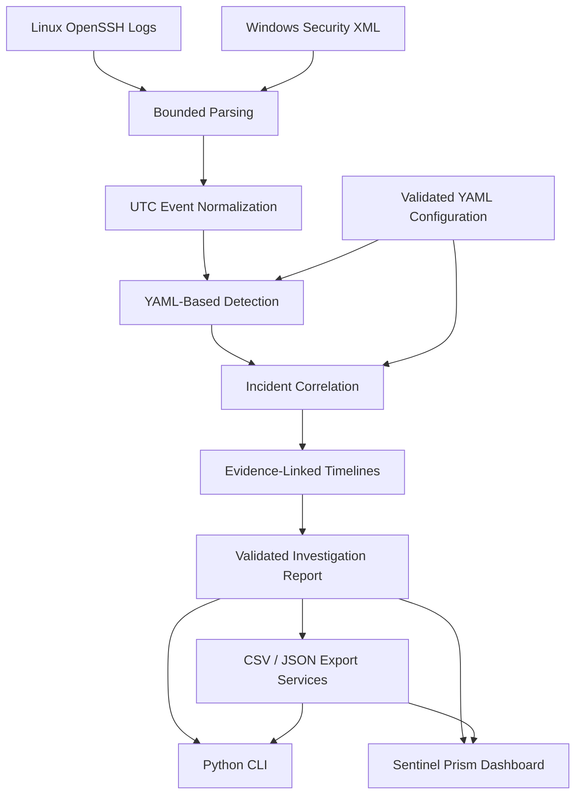
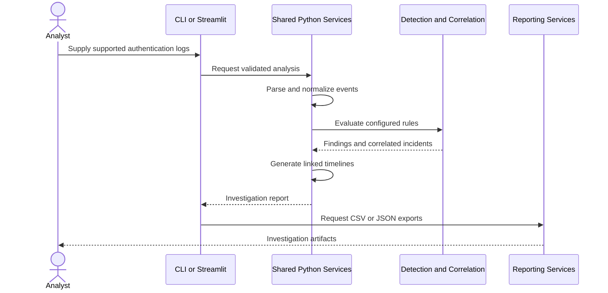
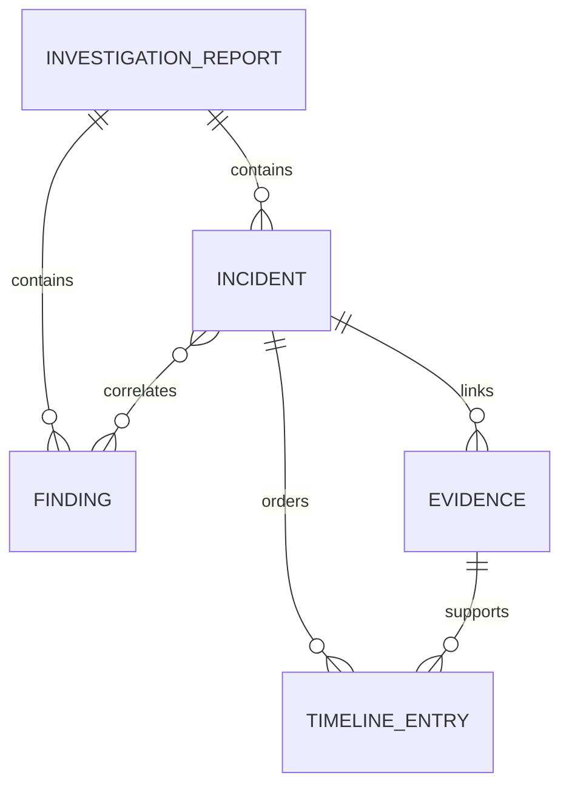

# Sentinel — Architecture and Security Boundaries

**Version:** 1.0.0  
**Status:** Implemented and accepted as a local portfolio prototype

## Architecture Overview

I designed Sentinel around a shared Python analysis backend.

The command-line interface and Streamlit dashboard use the same parsing, detection, correlation, validation, and reporting services.

This separation lets me improve the user interface without maintaining a second detection engine.

## Processing Pipeline

Editable diagram source: [architecture.mmd](diagrams/architecture.mmd).

## Main Components

| Component | Responsibility |
|---|---|
| `parsers/linux.py` | Supported Linux authentication log parsing |
| `parsers/windows.py` | Windows Security XML event parsing |
| `events.py` | Normalized security event representation |
| `detection/` | YAML-configured authentication detection |
| `correlation/` | Finding grouping and incident relationships |
| `investigation/` | Evidence-linked timelines and summaries |
| `workflow.py` | Unified raw-log analysis |
| `reporting/` | Validated CSV/JSON outputs |
| `quality/` | Synthetic evaluation and benchmarks |
| `portfolio.py` | Reproducible synthetic demo artifacts |
| `dashboard/service.py` | Framework-neutral dashboard adapters |
| `dashboard/app.py` | Streamlit presentation and interaction |
| `cli.py` | Command-line interface |

## Investigation Flow

Editable diagram source: [investigation.mmd](diagrams/investigation.mmd).

## Evidence Relationships

Editable diagram source: [evidence_relationships.mmd](diagrams/evidence_relationships.mmd).

## Architectural Decisions

### Reusable Backend

I kept parsing, detection, correlation, and reporting outside the Streamlit interface.

The dashboard consumes validated Python service outputs rather than implementing separate security rules.

### Normalized Event Model

I used a shared event representation to process supported Linux and Windows authentication information consistently.

Source references remain associated with evidence records to support traceability.

### Configuration Validation

The detection and correlation services use schema-validated YAML.

The dashboard's detection controls apply changes for the current browser session without directly overwriting committed configuration files.

### Offline-First Operation

Sentinel runs locally without a remote log collector, paid API, or database server.

The default Streamlit configuration binds the application to `127.0.0.1`.

## Security Boundaries

| Boundary | Implemented Control or Limitation |
|---|---|
| Raw log inputs | 16 MiB per supported file |
| Dashboard uploads | At most 4 files and 32 MiB combined |
| Normalized JSON | 32 MiB file limit |
| Existing investigation JSON | 50 MiB import limit |
| Linux log lines | 65,536-character limit |
| XML | DTD/entity declarations rejected |
| YAML | Validated schema and value constraints |
| Reporting | Relationship validation and CSV formula safeguards |
| Browser interface | Local binding; no application login system |

These controls do not eliminate all parsing, resource-exhaustion, or security risks.

## Investigation Boundaries

A detection finding is an indicator for review, not a confirmed security incident in a production environment.

Timeline entries include evidence linked to detection findings; they do not represent every event from the original log files.

The toolkit does not establish attacker attribution, complete chain of custody, or confirmed account compromise.

## Verification

At the completed Phase 10 acceptance milestone, the application passed 460 automated tests and all seven dashboard workspaces were manually accepted.

Later UI changes should be retested.

## Related Documentation

- [Dashboard Guide](WEB_DASHBOARD_GUIDE.md)
- [CLI Guide](CLI_GUIDE.md)
- [Reporting Guide](REPORTING_GUIDE.md)
- [Security Validation](SECURITY_VALIDATION_GUIDE.md)
- [Original Phase 10 Requirements](PHASE10_HANDOFF.md)
