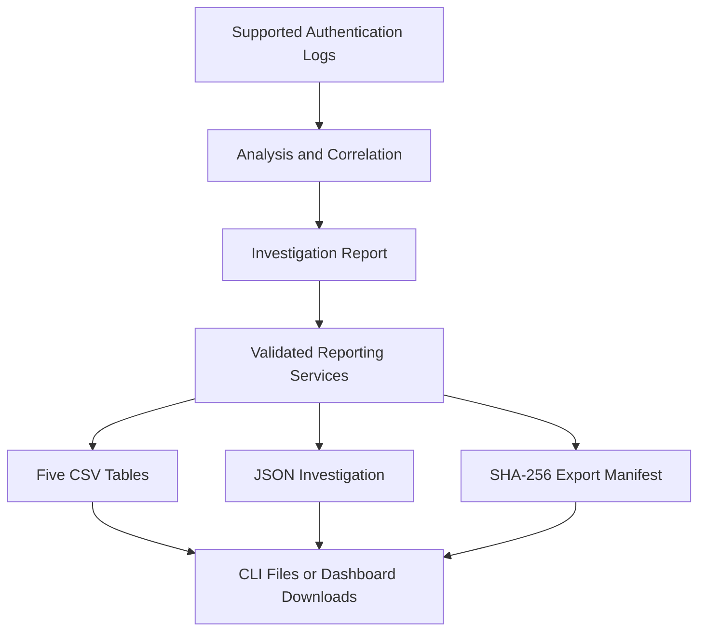

# Sentinel — Investigation Reporting and Export Guide

## Overview

I implemented structured reporting to turn authentication detection results into investigation artifacts that can be reviewed, filtered, and shared in authorized workflows.

The same reporting services are used by both the Python CLI and the Sentinel Prism dashboard.

Reporting does not generate new threat detections or independently determine whether a system was compromised.

## Reporting Workflow



## 1. Generate an Investigation

Run this example from the repository root:

```powershell
.\.venv\Scripts\python.exe -m security_log_toolkit analyze --linux samples/linux/attack_auth.log --windows samples/windows/attack_security.xml --year 2026 --utc-offset +08:00 --output reports/investigation.json
```

The command creates an investigation report from the bundled synthetic samples.

## 2. Display an Analyst Summary

```powershell
.\.venv\Scripts\python.exe -m security_log_toolkit report --input reports/investigation.json
```

The report summarizes normalized events, detection findings, incidents, severity, and linked investigation evidence.

## 3. Export CSV and JSON Files

```powershell
.\.venv\Scripts\python.exe -m security_log_toolkit export --input reports/investigation.json --format both --output-dir reports/investigation_exports
```

The `both` format produces seven files:

| File | Contents | Synthetic Demo Rows |
|---|---|---:|
| `summary.csv` | Investigation summary | 1 |
| `incidents.csv` | Incident details and associated findings | 4 |
| `findings.csv` | Detection findings | 6 |
| `evidence.csv` | Incident-linked evidence and source references | 22 |
| `timelines.csv` | Chronological linked activity | 22 |
| `investigation.json` | Structured nested investigation report | — |
| `export_manifest.json` | Export metadata, row counts, and hashes | — |

These counts apply to the bundled synthetic dataset.

## 4. Evidence Relationships

The exported tables preserve identifiers linking findings, incidents, and evidence records.

This makes it possible to follow an investigation from a detected pattern to the underlying source events.

Linked evidence is a subset of analyzed authentication activity, not a complete source-log history.

## 5. CSV Handling

The CSV exporter uses Python's CSV serialization.

The output includes formatting suitable for spreadsheet review, including UTF-8 encoding with BOM and Windows-compatible line endings.

Cells that resemble formulas are guarded to reduce common spreadsheet-injection risks.

These safeguards do not eliminate all risks associated with opening untrusted spreadsheet content.

## 6. Integrity Metadata

The export manifest contains SHA-256 hashes for generated artifacts.

A hash can help detect differences between a file and the recorded manifest.

It is not a digital signature, proof of authorship, or a complete forensic chain-of-custody mechanism.

## 7. Output Safety

The CLI validates investigation reports before exporting them.

Generated output folders are protected against accidental overwriting.

Selected commands allow controlled replacement with `--force`, subject to additional safeguards.

Generated investigation data should remain under Git-ignored local report directories rather than being published automatically.

## 8. Python Reporting Services

I designed the reporting layer so it can be reused without invoking the CLI.

```python
import json
from pathlib import Path

from security_log_toolkit.reporting import (
    build_report_tables,
    build_export_artifacts,
    summarize_report,
)

report = json.loads(
    Path("reports/investigation.json").read_text(
        encoding="utf-8"
    )
)

print(summarize_report(report))

tables = build_report_tables(report)

files = build_export_artifacts(report, "both")
```

The reporting API returns structured data and export bytes that can be used by the dashboard.

## 9. Sentinel Prism Report Center

The dashboard provides direct downloads for investigation JSON and CSV files.

The seven-file bundle includes the same reporting outputs and integrity manifest used by the CLI.

The dashboard generates download artifacts in memory; it does not automatically publish or upload investigation reports to an external service.

## 10. Older Report Compatibility

The reporting layer supports earlier investigation reports from the project's development phases.

A report without timeline information may still produce valid exports, with the timeline CSV containing headers but no timeline records.

An older report's internal version does not necessarily match the current installed toolkit version.

## 11. Privacy and Limitations

Authentication logs and derived reports may contain usernames, IP addresses, and sensitive infrastructure details.

I use bundled synthetic datasets for publicly shared portfolio demonstrations.

Real investigation records should only be handled and shared with appropriate authorization.

The reporting system does not replace a production forensic evidence-management process.

## Related Documentation

- [CLI Guide](CLI_GUIDE.md)
- [Architecture](ARCHITECTURE.md)
- [Dashboard Guide](WEB_DASHBOARD_GUIDE.md)
- [Security Validation](SECURITY_VALIDATION_GUIDE.md)
